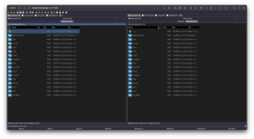

# Double Commander Theme Switcher (macOS)

Selector gráfico de temas para [Double Commander](https://github.com/doublecmd/doublecmd) en macOS.
Un botón de toolbar abre una grilla de tarjetas (miniatura + nombre) — un click aplica el tema
completo (colores + modo claro/oscuro) sin tocar nada a mano en la config de DC.



## Por qué existe

Las versiones recientes de Double Commander externalizaron los colores a `colors.json`
(`ConfigVersion` moderno). Los theme-changers viejos que escriben `<Foreground>`/`<Background>`
directo en `doublecmd.xml` ya no hacen nada en ese esquema. Este proyecto aplica el tema al
lugar correcto (`colors.json` + `DarkMode` en `doublecmd.cfg`) y maneja el ciclo de reinicio
de la app sin perder tabs abiertos.

## Componentes

- **`picker-ui/DCThemePicker.swift`** — UI nativa SwiftUI: grilla de temas con miniatura,
  un click aplica. Se compila sola al primer uso (`swiftc`, sin dependencias externas).
- **`dc_theme_picker.sh`** — botón de toolbar de DC: lanza el picker (compilándolo si hace
  falta); si no hay toolchain Swift, cae a un fallback con `osascript` (lista + Preview).
- **`dc_theme_phoenix.sh`** — aplica el tema. Si DC está corriendo, lo cierra con quit
  gracioso (conserva tabs/estado), aplica, y lo reabre. Si el usuario elige "al próximo
  inicio", aplica los colores en caliente y deja el `DarkMode` pendiente hasta el próximo
  cierre (evita la carrera con DC reescribiendo su propio `doublecmd.cfg`).
- **`dc_theme_apply.py`** — el motor: reemplaza el bloque `Style` correspondiente dentro de
  `colors.json` y el `DarkMode` de `doublecmd.cfg`, con backup automático antes de escribir.
- **`themes/`** — un tema por `<nombre>.json` (+ `.cfg` opcional con `DarkMode=0/1`) en el
  mismo formato que [t0mmili/dc-themes](https://github.com/t0mmili/dc-themes). Trae 4 paletas
  [Catppuccin](https://github.com/catppuccin/catppuccin) (Frappé, Latte, Macchiato, Mocha),
  VS Code 2024 y los dos temas default de DC.

## Instalación

```bash
git clone https://github.com/hernance/doublecmd-theme-switcher.git ~/bin/dc-theme
```

El picker asume esa ubicación exacta (`~/bin/dc-theme`, hardcoded en `DCThemePicker.swift`
y en los scripts). Si lo clonás en otro lado, ajustá `scriptDir` en el `.swift` y
`SCRIPT_DIR` en los `.sh`.

En Double Commander: **Configuración → Barra de herramientas → agregar botón**, comando
`~/bin/dc-theme/dc_theme_picker.sh`, ícono `icon/theme-icon-32.png`.

Requiere Xcode Command Line Tools (`swiftc`) para el picker gráfico; sin eso funciona igual
con el fallback de texto.

## Agregar un tema propio

Cualquier archivo `<nombre>.json` de [t0mmili/dc-themes](https://github.com/t0mmili/dc-themes)
(carpeta `schemes/`) funciona tal cual, poniéndolo en `themes/`. Para la miniatura de la
grilla: `sips -Z 280 captura.png --out themes/<nombre>.thumb.png`.

## Uso por línea de comandos

```bash
dc_theme_apply.py --list                          # temas disponibles
dc_theme_apply.py --apply vscode-2024              # aplica (con DC cerrado)
dc_theme_phoenix.sh catppuccin-mocha now            # cierra DC, aplica, reabre
dc_theme_phoenix.sh catppuccin-mocha stage          # aplica colores en caliente, resto al próximo inicio
```

## Créditos

- [Double Commander](https://github.com/doublecmd/doublecmd) — el file manager.
- [t0mmili/dc-themes](https://github.com/t0mmili/dc-themes) (MIT) — formato y origen de los
  archivos de tema en `themes/`.
- [Catppuccin](https://github.com/catppuccin/catppuccin) (MIT) — paleta de los 4 temas
  `catppuccin-*`.

## Licencia

MIT — ver [LICENSE](LICENSE).
