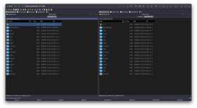

# Double Commander Theme Switcher (macOS)

A graphical theme switcher for [Double Commander](https://github.com/doublecmd/doublecmd) on macOS.
A toolbar button opens a grid of cards (thumbnail + name) — one click applies the complete
theme (colors + light/dark mode) without hand-editing DC's config.



## Why it exists

Recent versions of Double Commander moved colors out into `colors.json`
(modern `ConfigVersion`). Older theme changers that write `<Foreground>`/`<Background>`
directly into `doublecmd.xml` no longer do anything under that scheme. This project applies the
theme to the right place (`colors.json` + `DarkMode` in `doublecmd.cfg`) and handles the app's
restart cycle without losing open tabs.

## Components

- **`picker-ui/DCThemePicker.swift`** — native SwiftUI UI: a grid of themes with thumbnails,
  one click applies. It compiles itself on first use (`swiftc`, no external dependencies).
- **`dc_theme_picker.sh`** — DC toolbar button: launches the picker (compiling it if
  needed); if there is no Swift toolchain, it falls back to an `osascript` flow (list + Preview).
- **`dc_theme_phoenix.sh`** — applies the theme. If DC is running, it quits it gracefully
  (preserving tabs/state), applies the theme, and reopens it. If the user picks "on next
  launch", it applies the colors live and leaves `DarkMode` pending until the next
  quit (avoiding a race with DC rewriting its own `doublecmd.cfg`).
- **`dc_theme_apply.py`** — the engine: replaces the matching `Style` block inside
  `colors.json` and the `DarkMode` setting in `doublecmd.cfg`, with an automatic backup before writing.
- **`themes/`** — one theme per `<name>.json` (+ optional `.cfg` with `DarkMode=0/1`) in the
  same format as [t0mmili/dc-themes](https://github.com/t0mmili/dc-themes). Includes 4
  [Catppuccin](https://github.com/catppuccin/catppuccin) palettes (Frappé, Latte, Macchiato, Mocha),
  VS Code 2024, and DC's two default themes.

## Installation

```bash
git clone https://github.com/hernance/doublecmd-theme-switcher.git ~/bin/dc-theme
```

The picker assumes that exact location (`~/bin/dc-theme`, hardcoded in `DCThemePicker.swift`
and in the scripts). If you clone it elsewhere, adjust `scriptDir` in the `.swift` file and
`SCRIPT_DIR` in the `.sh` files.

In Double Commander: **Configuration → Toolbar → add button**, command
`~/bin/dc-theme/dc_theme_picker.sh`, icon `icon/theme-icon-32.png`.

Requires the Xcode Command Line Tools (`swiftc`) for the graphical picker; without them it still
works through the text fallback.

## Adding your own theme

Any `<name>.json` file from [t0mmili/dc-themes](https://github.com/t0mmili/dc-themes)
(`schemes/` folder) works as is, just drop it into `themes/`. For the grid thumbnail:
`sips -Z 280 screenshot.png --out themes/<name>.thumb.png`.

## Command-line usage

```bash
dc_theme_apply.py --list                          # available themes
dc_theme_apply.py --apply vscode-2024              # apply (with DC closed)
dc_theme_phoenix.sh catppuccin-mocha now            # quit DC, apply, reopen
dc_theme_phoenix.sh catppuccin-mocha stage          # apply colors live, the rest on next launch
```

## Compatibility

Tested with Double Commander 1.2.7 (build 359) on macOS. Verified on that version:

- `dc_theme_phoenix.sh <theme> now` with DC closed: applies the complete theme.
- `now` with DC open: quits gracefully, applies, and reopens; the pending `DarkMode` is applied before the theme.
- `stage` with DC open: applies only `colors.json` live and leaves `DarkMode` pending until the next quit.

Not tested on other DC versions.

## Credits

- [Double Commander](https://github.com/doublecmd/doublecmd) — the file manager.
- [t0mmili/dc-themes](https://github.com/t0mmili/dc-themes) (MIT) — format and origin of the
  theme files in `themes/`.
- [Catppuccin](https://github.com/catppuccin/catppuccin) (MIT) — palette for the 4
  `catppuccin-*` themes.

## License

MIT — see [LICENSE](LICENSE).
